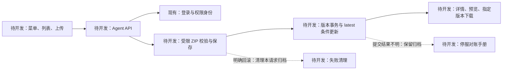

# Agent 托管技术设计复核

日期：2026-10-28。结论：**保留独立 Agent 领域与不可变 ZIP 的方案；原设计有实施边界缺口，已回写修正，可以据此拆分任务。** 这是设计审查，不是功能或测试通过证明。

后续开发已完成，本文件保留实施前的复核记录；当前功能与验证状态见[实施结果](../plans/2026-10-28-agent-hosting-results.md)。

面向实施者和验收者，先回答三个问题：现状能否接入、设计哪里需要补齐、用什么证据判定完成。

## 主流程和现状

下面全部 Agent 节点均待开发，认证、Gin/GORM 和 SPA 嵌入为现有能力。

源码核对：`pkg/server/server.go` 内联装配真实路由；`pkg/repository/db.go` AutoMigrate 当前模型；`web/src/App.tsx` 仍只有 Skill 页面；`Layout.tsx` 没有 Agent 菜单。Docker 配置实际位于 `deployments/docker/`，只挂了 Skill Git 卷，不能假设已有 Agent 持久化。现有 `pkg/agentplugin` 不是本次 Agent 资产模块。

## 发现与处理

| 编号 / 优先级 | 原设计问题或遗漏 | 本次明确的处理 | 对应任务 / 测试 |
| --- | --- | --- | --- |
| R1 / 高 | Commit 失败后，新查询暂时未找到版本，仍不能断言事务未提交；清理可能造成数据丢失 | 所有不明提交保留 ZIP；独立限时查询仅用于确认成功；否则 503 `publish_outcome_unknown`，停服对账 | T3 / S07–S09 |
| R2 / 高 | 只描述 CAS/唯一约束，没有落到实际驱动错误；当前未启用 TranslateError；所有重叠请求只能一个成功的描述过强 | Agent repository 局部按驱动码分类；明确同旧值竞争、串行观察新值两种合法结果；不自动重试 | T2、T3 / D03–D06、S04–S06 |
| R3 / 高 | 目录条目可能绕过正文检查；zip.NewReader 之后才数条目无法约束解析阶段分配 | 所有条目校验，目录正文必须空；中央目录预检实际记录数和 2 MiB 大小；至少一个普通文件 | T1 / A05–A10 |
| R4 / 中 | multipart 元数据上限、tags 编码和解析失败清理未定；字段重复可能被悄悄忽略 | 非文件值合计 1 MiB、tags 为 JSON 数组；拒绝未知/重复字段，所有解析路径清临时文件 | T4 / H01–H05 |
| R5 / 中 | 列表可能连带返回大文件清单或用户资料；分页溢出和 Unicode 搜索承诺模糊 | 固定摘要 DTO；int64 溢出拒绝；ASCII 忽略大小写、中文子串；转义 LIKE 字面通配符 | T2、T4 / D07–D09、H07 |
| R6 / 中 | 公开下载/预览缓存可能与软删除语义冲突；预览“非明显二进制”不够明确 | no-store、纯文本+nosniff；明确控制字符判定及在途下载边界 | T4、T6 / H08–H10、E06 |
| R7 / 中 | Cookie 认证不等于完整跨源写防护；目前无该中间件 | Agent 写路由复用标准库 CrossOriginProtection.Check，保持同源和常规 Bearer 客户端可用 | T4 / H06 |
| R8 / 中 | 未登录发布入口、更新版本 URL、模式切换和请求过期行为不够具体 | 导航/列表发布入口常显；登录保留 URL；锁 slug/kind；换模式清文件，版本详情/下载绑定同一明确版本 | T5、T6 / E01–E08 |
| R9 / 高 | 当前SQLite连接串使用其他驱动的WAL参数，真实运行仍是delete模式，WAL并发前提不成立 | T2改为当前驱动支持的 `_pragma` 参数；通过真实连接和连接池PRAGMA断言，不只在测试手工开启 | T2 / D01、D06 |

R2 的源码依据：`pkg/repository/db.go` 的 GORM 配置只有 Logger；安装的 glebarez/sqlite v1.11.0 提供 Translate，但默认不会自动启用；现有 PostgreSQL 驱动为 pgx/v5。不要对照另一个 SQLite 驱动写类型断言。

R9 在本次复核做了最小运行取证（不是Agent测试）：用安装的glebarez/go-sqlite，在系统临时目录新建两库，旧参数返回 `delete/5000`，`_pragma=journal_mode(WAL)&_pragma=busy_timeout(5000)` 返回 `wal/5000`；未触碰用户本地数据库。取证程序保存在 `C:/Users/xll/.local/state/skillhub/baseline-repair/design-dsn-check.go`。busy_timeout相同来自驱动默认值，不说明旧DSN参数有效。

## 可接受的首期取舍

- 所有 Agent 公开，single/suite 只做分类，作者说明如何在本地工具运行；平台不验证协作流程能否执行。
- 全量版本 ZIP 占用重复空间；无在线垃圾回收、配额、存储插件或运行引擎。只支持当前单实例，登录用户上传仍需部署方管理容量。
- 资产名称/简介/标签展示当前值；旧版本保证文件、使用说明和更新说明不变，不承诺历史资产元数据快照。
- ZIP 上传保持原 ZIP 字节；文件夹上传无法保留浏览器没有提交的空目录和可执行权限。目录、格式及资源限制仍适用于 ZIP。
- 删除阻止后续服务端读取，无法撤回已下载副本或已开始的传输。离线备份/恢复需同时覆盖数据库和归档。

## 完成门槛

按[实施任务](../plans/2026-10-28-agent-hosting.md)推进，[测试方案](../plans/2026-10-28-agent-hosting-tests.md)按层给证据。SQLite、本地浏览器、PostgreSQL、Docker 分别标记结果；没有环境的测试不得写成通过。现有基线验证不能替代 Agent 登录上传闭环。

外部依据均为一手文档：[Go ZIP 读取与校验](https://pkg.go.dev/archive/zip)、[Go 请求体限制](https://pkg.go.dev/net/http#MaxBytesReader)、[Go 跨源写保护](https://pkg.go.dev/net/http#CrossOriginProtection.Check)、[GORM 错误翻译需要显式启用](https://gorm.io/docs/error_handling.html#Dialect-Translated-Errors)、[SQLite WAL 快照与写竞争](https://www.sqlite.org/isolation.html)、[SQLite 错误码](https://www.sqlite.org/rescode.html)、[PostgreSQL Read Committed](https://www.postgresql.org/docs/17/transaction-iso.html)。这些资料用于核实边界，不构成项目运行验证。
